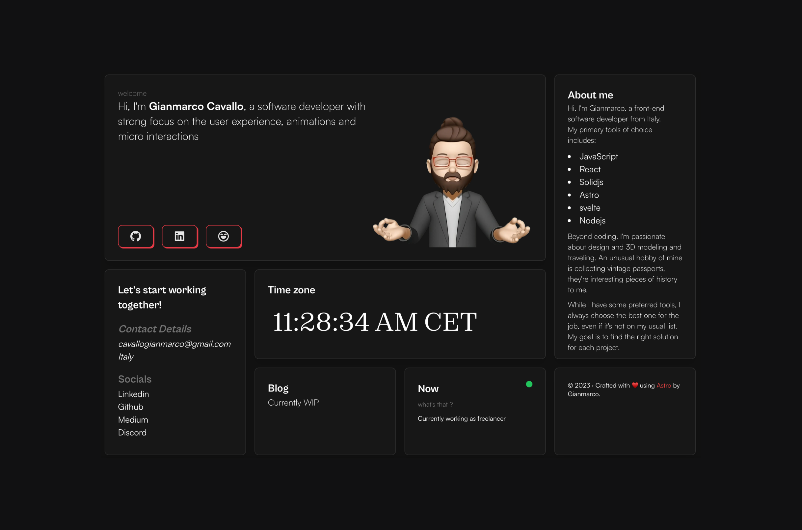

# ⚡️astro-bento-portfolio

## A personal portfolio website made using `Astro`.



To view a demo example, **[click here](https://sparkly-speculoos-0c9197.netlify.app/)**

or my portfolio **[click here](https://gianmarcocavallo.com)**

## Features

- Modern and Minimal bento-like, sleek UI Design
- All in one page (almost)
- Fully Responsive
- Performances and SEO optimizations
- Ready to be deployed on [Netlify](https://www.netlify.com/)
- Blog
- RSS support (your-domain/rss.xml)
- Cool 3d globe

## Tech Stack

- [Astro](https://astro.build)
- [unocss](https://unocss.dev/)
- [motion](https://motion.dev/)
- [d3](https://d3js.org/)

# Steps ▶️

```bash
# Clone this repository
$ git clone https://github.com/Ladvace/astro-bento-portfolio
```

```bash
# Go into the repository
$ cd astro-bento-portfolio
```

```bash
# Install dependencies
$ pnpm install
or
$ npm install
```

```bash
# Start the project in development
$ pnpm run dev
or
$ npm run dev
```

# Be sure to replace the momoji and all the relative information, such as email, website and other info, if you don't your website is gonna point to my domain and to my info

## REMOVE THE umami analytics script tag (or replace it with your id) in `src/layouts/Layout.astro`

# Configuration

remember to replace the `site` and other properties with your data in `astro.config.mjs`

# Deploy on Netlify 🚀

Deploying your website on Netlify it's optional but I reccomand it in order to deploy it faster and easly.

You just need to fork this repo and linking it to your Netlify account.

or

[](https://app.netlify.com/start/deploy?repository=https://github.com/Ladvace/astro-bento-portfolio)

## Authors ❤️

- Gianmarco - https://github.com/Ladvace

## Codex token usage

The homepage shows **Codex + OpenAI API recorded token totals**, with combined
daily activity under the simple **Token usage** heading. There is no separate
usage detail page. **Estimated cost** values the same recorded tokens once:

- For primary-only dates after the archive cutoff, usable official daily
  analytics samples supply a credit/token rate. The estimate is
  `Profile daily tokens / analytics sample tokens × sample credits × $0.04`.
  `$0.04/credit` is the user-selected community reference value in
  `src/data/codex-credit-valuation.json`, not a universal official purchase price.
  Only recognized Codex surfaces are sampled; Work and unknown surfaces are
  excluded. Profile and analytics counts differ, so this is explicitly daily
  rate extrapolation, not exact matching or reconstruction of model token counts.
- Earlier two-account history and dates without usable credit samples use the
  token-weighted average of those **same official credit samples**:
  `remaining Profile tokens × sum(sample credits) × $0.04 / sum(sample tokens)`.
  This also covers undated lifetime tokens. Only samples on positive, available
  Profile dates after the archive cutoff enter the average; future samples do
  not change historical estimates early. Zero credits with positive usage do
  not prove free usage and therefore use the average of valid samples.

Daily estimates and historical extrapolation use the same credit valuation;
local-log prices no longer affect the homepage cost. Historical credits remain
inferred, not recovered. Using the primary account's sample rate for earlier
two-account usage assumes their average cost per token is comparable. It does
not reconstruct their historical model mix. Each recorded token is valued once;
neither sample tokens nor sample costs are added to recorded totals.

API tokens are estimated per model using uncached input, cached input and output
rates from `src/data/token-prices.json`, checked against the linked official
price table. The current approximation assumes Standard short-context pricing;
speed, long-context and cache-write surcharges are not collected in these buckets.
Unknown model prices or unpriceable Codex tokens show an unavailable estimate rather
than a misleading partial sum. Collected billing costs are retained separately
and are not added again to the estimate. The tooltip shows both source estimates
and these assumptions. This is an approximate value, not subscription spending.
Cached input
is counted once. Each service's date buckets are preserved; a day awaiting one
source is marked partial. Local estimates are never added to these totals.

`src/data/codex-local-estimate.json` is retained for diagnosis only and is not
imported by the homepage estimator. It is a partial local-log report from
**ccusage 20.0.48**, including only aggregate model counts, dates,
and API-equivalent estimated USD, never prompts, session paths, IDs, or account
identifiers. Its retained history can span accounts and does not represent the
complete account-wide archive. Fallback metadata/model aliases remain marked.
It is an estimate, not subscription charges or an actual API invoice.

To explicitly refresh it on the Mac, run the pinned `ccusage@20.0.48` tool:

```bash
ccusage codex daily --json --timezone Asia/Shanghai > /tmp/codex-estimate.json
python3 scripts/import_codex_estimate.py /tmp/codex-estimate.json \
  --output src/data/codex-local-estimate.json
```

The diagnostic local report is not available to GitHub runners and is not
automatically refreshed. It is no longer required for cost updates. Account
totals, official credit samples and API statistics continue their automatic
updates; the combined estimate is recalculated at every build. API prices and
the community credit reference value are versioned separately.

### Official Codex desktop dashboard (OAuth verification)

The existing ChatGPT OAuth login can read the desktop dashboard's model/speed
breakdown; it does not require the OpenAI API Admin key. A read-only collector is
available for local inspection:

```bash
python3 scripts/codex_dashboard.py --auth-file "$HOME/.codex/auth.json" \
  --start-date 2026-10-05 --end-date 2026-11-04 \
  --output /tmp/codex-dashboard.json
```

It also accepts the existing `CODEX_AUTH_JSON` environment variable, uses a fixed
OpenAI destination, refuses redirects, never refreshes/writes credentials, and
exports only allowlisted aggregate model/speed values. Request at most 31 days
per read. This diagnostic collector is not wired into the Pages frontend or
the automatic workflow.

Verified on **2026-11-04**, using the routes and request formats in the installed
official desktop client:

- `GET /backend-api/wham/usage/daily-token-usage-breakdown` succeeds. For the
  currently signed-in personal account, the response has `units: "percent"`.
  Its model field is named `credits` even when those values are percentages;
  the collector exports it as `usageValue` and preserves the explicit unit.
- The workspace input/cache/output breakdown returns HTTP 400 for this account;
  the thread USD/credit breakdown returns HTTP 403. These requests are not
  included in the collector and no attempts are made to bypass their access rules.

Percentages are not model token counts, cannot be added to the homepage total,
and cannot be multiplied by per-token prices to produce USD. They also cannot
reconstruct the retired account's history.

Further source research and a read-only OAuth probe on **2026-11-04** found a
different, working route: `GET /backend-api/wham/analytics/daily-workspace-usage-counts`
with `workspace_user=true`. It returns absolute daily credits and uncached,
cached and output token totals for the tested personal account. This does not
contradict the failures of the two different endpoints above. However, its
model rows have no token fields and all model-credit values were zero in the
tested history. The response includes Work surfaces, returns only part of the
requested lifetime history, and represents just the currently signed-in
account. The official credits-to-USD estimate endpoint also returned HTTP 403.
Do not substitute this partial history for the two-account lifetime total or
label a configurable credit-to-USD reference rate as an actual bill.

Following the user's acceptance of the community reference valuation on
**2026-11-05**, `scripts/codex_credits.py` collects daily absolute samples inside
the existing managed primary OAuth flow, after credential renewal. The samples
are stored as optional `creditUsage` in `src/data/codex-profile.json`, starting
the day after the two-account archive. The initial read backfills that period;
subsequent reads refresh the last seven saved days and new days. Dates replace
previous values rather than accumulating, and older saved rows survive rolling
retention. Only validated aggregate dates, counts and credits are published.

Credit queries are optional: errors preserve old samples, still allow Profile
tokens to update and do not block deployment. The same artifact and persistence
job carry both kinds of statistics; no extra credential or schedule is needed.
The frontend ignores credit dates outside Profile's available daily history.
The earlier discrepancy between Profile and analytics is accepted as an
estimation assumption, not declared resolved. See
[the source investigation](docs/research/codex-cost-sources-2026-11-04.md) for
the verified alternatives and remaining limitations. These dashboard endpoints
are internal client APIs, so their shapes and availability can change
independently of the documented app-server API.

### OpenAI API model statistics

The API collector uses the official
[organization completions usage endpoint](https://developers.openai.com/api/reference/resources/admin/subresources/organization/subresources/usage/methods/completions),
grouped by model. It collects organization-wide input, cached input, output,
and request counts. **Total tokens = input + output**; cached input is already
part of input. Token totals cover this endpoint only. A separate `costs` section uses the
organization Costs API, grouped by billing line item, with exact decimal USD
amounts. Costs may include other API services and may lag token usage. They are
reported usage costs, not subscription charges, payment receipts, or list-price
estimates. Cost collection refreshes the recent seven days; unavailable costs
retain their previous coverage without blocking token updates. API dates include the current UTC day (still updating), kept separate from Codex's
service-defined daily buckets.

Configure these in this website repository's Actions settings:

| Type | Name | Value |
| --- | --- | --- |
| Secret | `OPENAI_USAGE_ADMIN_KEY` | An Admin API Key with usage read permission |
| Variable | `OPENAI_USAGE_START_DATE` | First day to collect, `YYYY-MM-DD`, today UTC or earlier |
| Variable | `OPENAI_USAGE_SYNC_ENABLED` | Set `true` after choosing the date and configuring the key |

The key is available only to the isolated query step. Build artifacts and the
repository receive only allowlisted dates, model names, and numeric counts.
No account, project, API key identifiers, prompts, or response bodies are saved.
Use a personal organization: this version collects **all projects** in that
organization. Do not change organizations without explicitly resetting or
migrating the saved API history. An ordinary project inference key is not a
replacement for an Admin Key.

`src/data/openai-usage.json` starts unconnected (`null` dates), which the page
renders as unavailable rather than zero. The first enabled run backfills the
configured interval with pagination. Later runs re-read the last 7 saved days
and append newer days; repeated dates replace, rather than add to, previous
counts. Empty results in a returned bucket are zero; missing buckets, incomplete
coverage, malformed responses, or expired credentials fail the API job and keep
the previous snapshot. Other collectors and deployment can still proceed.
Only a successfully deployed snapshot is persisted to `master`.

For a local full-history audit (the key must already be in the environment):

```bash
python3 scripts/openai_usage.py collect --full \
  --previous src/data/openai-usage.json \
  --start-date YYYY-MM-DD --snapshot /tmp/openai-usage.json
```

Use `--full` to reconcile corrections older than the routine 3-day refresh
window. Changing the starting date requires an explicit history migration.
Run `pnpm run usage:test` and `pnpm run usage:validate` to check both sources.

### Codex account history

The homepage's Token usage heatmap preserves the two-account history through
**2026-10-24** in `config/codex-usage-archive.json`. From **2026-10-25**, only the
original primary account contributes new daily usage. The reviewed archive keeps
all 236 historical buckets and 19,685,521,977 tokens unchanged. It is a combined
archive: the old collector did not retain per-account snapshots, so no individual
account history is invented. Account identifiers and email addresses are never
exported. Its reverse side is Recent work. `/usage-preview/` retains
the alternate visualizations. Local session history is not used.

```bash
pnpm run usage:test
pnpm run usage:validate
```

This repository's Pages workflow collects usage and renews the primary account's
dedicated managed login using the official Codex client. The `sync-codex` job
saves the refreshed login back to its encrypted environment Secret and exports
only validated public statistics. The retired second account is neither read nor
renewed and cannot cause collection or login reminders to fail. Build and deployment jobs
receive that snapshot without any Codex credentials. After a successful deployment, the workflow saves the same
snapshot on `master` using `GITHUB_TOKEN`, without triggering a second run.
No additional repository, data branch, or daily Mac process is needed. Failed
collection keeps the previous Codex snapshot while other modules can still deploy. The workflow fixes the
active account count to one and no longer references second-account Secrets or
the old `CODEX_ACCOUNT_COUNT` repository variable.

Every new total is the fixed archived total plus primary-account daily buckets
after the cutoff. Repeated dates replace their current value instead of being
added again. Previously collected primary-only days survive a rolling service
window. The `archivedThrough` marker distinguishes migrated data from old live
two-account aggregates, so a legacy cloud run cannot be mistaken for primary-only
history. Corrections before the cutoff do not rewrite the preserved archive.

The public snapshot contains only its schema version, source, fetch timestamp,
lifetime token total, dated daily totals, and the archive cutoff date when present. Validation rejects extra fields,
invalid numbers, duplicate or unsorted dates, and inconsistent totals. The
Pages workflow runs the usage tests and validates this snapshot before building;
these checks do not read credentials or contact Profile.

Daily dates retain the service's original buckets. The wall shows 52 weeks,
and Last 7 days ends on the last reported day, including explicit zero values.
Unreported trailing days stay blank. Hovering, tapping, or focusing a day shows
a compact token count (K/M/B); arrow keys move between days. Narrow screens can
scroll the wall horizontally, starting at the recent end. The homepage card shares
the same flip controller as every other card. Each face has its own countdown:
8–14 seconds on the front and 6–10 seconds on the back. Mouse entry immediately
switches to the opposite face and pauses its fresh countdown; mouse exit switches
faces again and starts the newly shown face's full countdown. Flip buttons also switch faces and reset
the countdown, which stays paused while hovered. Ordinary clicks, including heatmap
dates, do not change the timer or leave it paused after exit. Keyboard navigation
and editing retain focus protection. Reduced motion disables automatic flipping.

Codex shares the existing daily Pages schedule at **00:00 Asia/Shanghai**
(16:00 UTC on the previous day; GitHub may queue runs). `CODEX_SYNC_ENABLED=true` enables collection
on scheduled runs and website updates. Manual runs offer `sync_codex` and
`dry_run`; a dry run still saves refreshed credentials but does not deploy or
commit statistics. Existing Enode synchronization remains in the same workflow.

Every Profile response replaces matching primary-account dates, including late
upward or downward revisions, without adding the same date twice or rewriting
the frozen two-account archive. API tokens, billing costs and credit samples
re-read the last seven saved dates and preserve older history. Counts do not
have an upstream finalization flag. The last seven days are labelled provisional;
older dates may also change when the source supplies a correction.

Successful rechecks persist `generatedAt` even when counts do not change. The
homepage shows the earlier of the two configured sources' successful check times,
with separate source times in its tooltip, so one healthy source cannot hide a
stale one. This is a check time, not a promise that the reporting day is complete.
Date buckets remain source-defined; they are not silently relabelled as Beijing
calendar days. Estimated cost is recalculated from the updated recorded tokens.

### Authentication setup

| Location | Name | Purpose |
| --- | --- | --- |
| `codex-auth` environment Secret | `CODEX_AUTH_JSON` | Independent managed login, replaced after renewal |
| `codex-auth` environment Secret | `CODEX_ACCOUNT_ID` | Pin the first selected account |
| `codex-auth` environment Secret | `CODEX_APP_PRIVATE_KEY` | Sign short-lived Secret write-back tokens |
| Repository variable | `CODEX_APP_ID` | Owner-only GitHub App identity |
| Repository variable | `CODEX_APP_INSTALLATION_ID` | Installation on this website repository only |
| Repository variable | `CODEX_SYNC_ENABLED` | Enable only after verified cloud runs |

The GitHub App needs only **Environments: read and write**, with metadata read
access, installed on `februarysea/februarysea.github.io`. The normal workflow
token saves public data; the App has no code-writing permission. Its temporary
token is revoked after collection. The `codex-auth` environment permits only
the `master` branch. Pull request checks never access its Secrets.

Environment Secrets are loaded when a job starts, and the Pages workflow's
concurrency group serializes renewal. Credentials are saved immediately after
refresh and again when the client exits; failure to save prevents publication of new Codex statistics.
Use a separate `codex login` for the primary account, never its active desktop session.
The second-account Secrets are no longer referenced; their remote removal is
separate from this local change and is not needed to retain historical counts.
Delete the primary bootstrap copy once two cloud runs verify renewal and reuse.
Revoked or invalidated refresh tokens can require a fresh independent login.

The repository and Actions logs are public. Never commit auth files or PEM keys,
print raw account responses, or upload the auth directory as an artifact. The
collector masks credential values and exports an allowlist of numeric/date
fields. References: [Codex CI authentication](https://learn.chatgpt.com/docs/auth/ci-cd-auth)
and [GitHub environment Secrets](https://docs.github.com/en/actions/concepts/security/secrets).

## P7 pet observations

The pet card uses `src/data/p7-summary.json`. Each graph shows daily medians of
accepted observations; its headline shows the latest accepted individual weight.
Visit counts and median durations remain in the data snapshot for later analysis;
they are not shown on the card. Missing days are left unfilled. Cat identity is **inferred from
weight**, not supplied by the device, and the original owner-provided breeds and
birthdays remain unchanged.

`config/p7-rules.json` separates Tangyuan (reference 6.3 kg) and Doubao (4.85 kg)
using non-overlapping ±0.6 kg bands. Out-of-band readings are excluded first.
Within each cat's band, observations within 14 days of a reading are compared
using median absolute deviation (MAD). With at least five samples, deviations
greater than `max(0.25 kg, 3 × 1.4826 × MAD)` are excluded. These configurable
measurement-quality rules need review if the cats' usual weights change.
Exclusions remain in the local audit; only accepted measurements affect cards.

To import a previously verified local snapshot (paths are examples):

```bash
python3 scripts/p7_sync.py import \
  --source /path/to/p7-cloud-history.json \
  --device-config /path/to/p7-device.json \
  --state config/p7-sync-bootstrap.json \
  --output-dir .p7-private/output
python3 scripts/p7_sync.py validate \
  --state .p7-private/output/sync-state.json \
  --public .p7-private/output/p7-summary.json \
  --previous src/data/p7-summary.json
cp .p7-private/output/p7-summary.json src/data/p7-summary.json
```

The `sync-p7` job is disabled by default. After reviewing and deploying the local
changes, configure these Secrets in a `p7-auth` environment restricted to `master`:

| Secret | Purpose |
| --- | --- |
| `P7_APP_PROFILE_JSON` | Verified PETSEE request-signing profile |
| `P7_SESSION_JSON` | Authorized PETSEE session, including its API region |
| `P7_DEVICE_ID` | Pin this P7 device |

Test with manual `sync_p7=true`, `dry_run=true` before setting repository variable
`P7_SYNC_ENABLED=true`. It shares the existing daily schedule. The collector only
reads weight/duration history and reuses the authorized session; there is no
unverified login or refresh endpoint. Complete, matching DP107/109 representations
are required. Reports may arrive one second apart, but weight, duration and the
embedded visit time must agree, with exactly one matching report on each side.
Ambiguous, conflicting or missing reports still fail validation. The text report
anchors each visit's identity and date to preserve existing archive keys.
Date-level observations are deduplicated and retained in `p7-data`
after successful deployment, so a shrinking cloud window does not erase history.
Only `sync-state.json` and `p7-summary.json` are uploaded; no credentials, raw API
responses, precise visit timestamps or rejection-audit files enter artifacts.
After deployment, the public summary is also saved on `master`, matching the
Codex statistics flow. Dry runs never save checkpoints or public snapshots.

The durable archive is `sync-state.json` on the `p7-data` branch, alongside
the daily summaries in `p7-summary.json`. Archived observations have no automatic expiry; the
seven-day Actions artifact retention applies only to temporary transfer files.
The fetch window covers the latest seven calendar days, so a longer interruption
can leave gaps. Persistence requires P7 collection and the website deployment to
succeed; an unrelated Training or Codex collection failure does not block it.

```bash
python3 -m unittest discover -s scripts -p 'test_p7*.py'
python3 -m unittest discover -s scripts -p 'test_sync_status.py'
node --test scripts/test-pet-weight.mjs
```

## Synchronization failure email

Training, the active primary Codex account, and P7 fail their Actions job if
collection fails. Confirmed authentication failures add a **sign-in required**
annotation and run summary with the affected module, Codex account slot when
known, and the Secret to replace. Network, rate-limit, storage and data-validation
errors are kept separate and do not claim that a login expired. Each collector
is independent: a failed collection skips that module's new artifact and
checkpoint, while successful modules and website changes still build and deploy.
Codex and P7 reuse their saved snapshots on `master`. Training restores its last
deployed checkpoint from `enode-data`; if that archive is unavailable, a warning
is recorded and the checked-in Training snapshot is kept. Build or deployment
failures still prevent all new checkpoints from being saved. A collector failure
keeps the overall run marked failed for notification even if deployment succeeds.

GitHub sends the failure email, so no SMTP credentials or additional reminder
service is needed. In [GitHub notification settings](https://github.com/settings/notifications),
enable Actions email notifications and choose failed workflows only. This is an
account preference; adding the workflow does not enable it automatically. The
email links to the failed run and its recovery instructions. Scheduled runs
notify the workflow owner/cron editor or the user who re-enabled the schedule;
confirm that recipient during rollout. Failure-only email also covers network
and build failures and may repeat while a problem remains unresolved.
See [GitHub's workflow notification rules](https://docs.github.com/en/actions/concepts/workflows-and-actions/notifications-for-workflow-runs).
