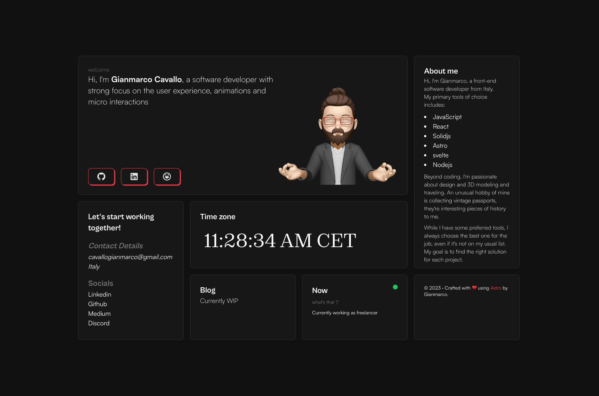

# ⚡️astro-bento-portfolio

## A personal portfolio website made using `Astro`.



To view a demo example, **[click here](https://sparkly-speculoos-0c9197.netlify.app/)**

or my portfolio **[click here](https://gianmarcocavallo.com)**

## Features

- Modern and Minimal bento-like, sleek UI Design
- All in one page (almost)
- Fully Responsive
- Performances and SEO optimizations
- Ready to be deployed on [Netlify](https://www.netlify.com/)
- Blog
- RSS support (your-domain/rss.xml)
- Cool 3d globe

## Tech Stack

- [Astro](https://astro.build)
- [unocss](https://unocss.dev/)
- [motion](https://motion.dev/)
- [d3](https://d3js.org/)

# Steps ▶️

```bash
# Clone this repository
$ git clone https://github.com/Ladvace/astro-bento-portfolio
```

```bash
# Go into the repository
$ cd astro-bento-portfolio
```

```bash
# Install dependencies
$ pnpm install
or
$ npm install
```

```bash
# Start the project in development
$ pnpm run dev
or
$ npm run dev
```

# Be sure to replace the momoji and all the relative information, such as email, website and other info, if you don't your website is gonna point to my domain and to my info

## REMOVE THE umami analytics script tag (or replace it with your id) in `src/layouts/Layout.astro`

# Configuration

remember to replace the `site` and other properties with your data in `astro.config.mjs`

# Deploy on Netlify 🚀

Deploying your website on Netlify it's optional but I reccomand it in order to deploy it faster and easly.

You just need to fork this repo and linking it to your Netlify account.

or

[](https://app.netlify.com/start/deploy?repository=https://github.com/Ladvace/astro-bento-portfolio)

## Authors ❤️

- Gianmarco - https://github.com/Ladvace

## Codex token usage

The homepage's Token usage heatmap uses the signed-in Codex Profile's daily
token buckets and lifetime total from `src/data/codex-profile.json`. Its reverse
side is Recent work. `/usage-preview/` retains the alternate visualizations.
Local session history and other accounts are not combined with this data.

```bash
pnpm run usage:test
pnpm run usage:validate
```

This repository's Pages workflow collects usage and renews a dedicated managed
login using the official Codex client. The `sync-codex` job refreshes the login,
saves it back to an encrypted environment Secret, and exports only validated
public statistics. Build and deployment jobs receive that snapshot without any
Codex credentials. After a successful deployment, the workflow saves the same
snapshot on `master` using `GITHUB_TOKEN`, without triggering a second run.
No additional repository, data branch, or daily Mac process is needed. Failed
collection leaves the previous website snapshot in place.

The public snapshot contains only its schema version, source, fetch timestamp,
lifetime token total, and dated daily totals. Validation rejects extra fields,
invalid numbers, duplicate or unsorted dates, and inconsistent totals. The
Pages workflow runs the usage tests and validates this snapshot before building;
these checks do not read credentials or contact Profile.

Daily dates retain the service's original buckets. The wall shows 52 weeks,
and Last 30 days ends on the last reported day, including explicit zero values.
Unreported trailing days stay blank. Hovering, tapping, or focusing a day shows
its exact token count; arrow keys move between days. Narrow screens can scroll
the wall horizontally, starting at the recent end.

Codex shares the existing daily Pages schedule at **00:00 Asia/Shanghai**
(16:00 UTC; GitHub may queue runs). `CODEX_SYNC_ENABLED=true` enables collection
on scheduled runs and website updates. Manual runs offer `sync_codex` and
`dry_run`; a dry run still saves refreshed credentials but does not deploy or
commit statistics. Existing Enode synchronization remains in the same workflow.

### Authentication setup

| Location | Name | Purpose |
| --- | --- | --- |
| `codex-auth` environment Secret | `CODEX_AUTH_JSON` | Independent managed login, replaced after renewal |
| `codex-auth` environment Secret | `CODEX_ACCOUNT_ID` | Pin the selected account |
| `codex-auth` environment Secret | `CODEX_APP_PRIVATE_KEY` | Sign short-lived Secret write-back tokens |
| Repository variable | `CODEX_APP_ID` | Owner-only GitHub App identity |
| Repository variable | `CODEX_APP_INSTALLATION_ID` | Installation on this website repository only |
| Repository variable | `CODEX_SYNC_ENABLED` | Enable only after verified cloud runs |

The GitHub App needs only **Environments: read and write**, with metadata read
access, installed on `februarysea/februarysea.github.io`. The normal workflow
token saves public data; the App has no code-writing permission. Its temporary
token is revoked after collection. The `codex-auth` environment permits only
the `master` branch. Pull request checks never access its Secrets.

Environment Secrets are loaded when a job starts, and the Pages workflow's
concurrency group serializes renewal. Credentials are saved immediately after
refresh and again when the client exits; failure to save prevents publication.
Use a separate `codex login` for bootstrap, never the active desktop session.
Delete the bootstrap copy once two cloud runs verify renewal and reuse.
Revoked or invalidated refresh tokens can require a fresh independent login.

The repository and Actions logs are public. Never commit auth files or PEM keys,
print raw account responses, or upload the auth directory as an artifact. The
collector masks credential values and exports an allowlist of numeric/date
fields. References: [Codex CI authentication](https://learn.chatgpt.com/docs/auth/ci-cd-auth)
and [GitHub environment Secrets](https://docs.github.com/en/actions/concepts/security/secrets).
